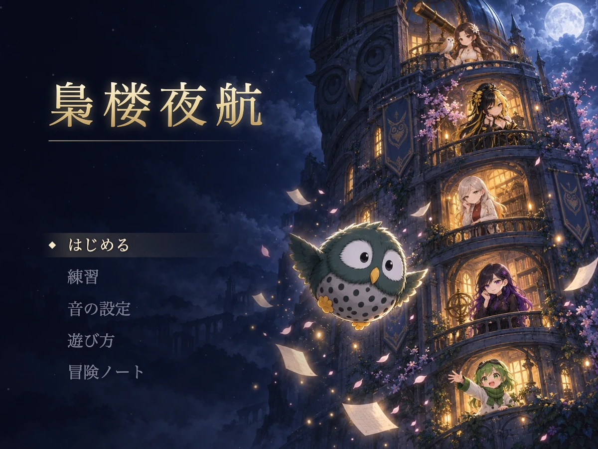

# 梟楼夜航 — きょうろうやこう

owleryのメンバーが登場する、ブラウザ向けの弾幕シューティングです。

差出人のない招待状を手に、みみこが梟楼の弾幕祭りへ。
仲間たちとの本気の勝負を越え、最上階の天文台を目指します。



[ブラウザで遊ぶ](https://tadashi-aikawa.github.io/kyoro-yako/) · [PVを見る](https://www.youtube.com/watch?v=7sD5zUuMwQQ)

## 遊び方

PCのブラウザで遊べます。Chromeで動作を確認しています。
キーボードが必要です。スマートフォン・タッチ操作には対応していません。

タイトルの「はじめる」から難易度を選んで開始します。

画像・BGM・動画の準備が必要なときは、読み込み画面が表示されます。
通信に失敗したときは、読み込み直すか、タイトルへ戻るかを選べます。
音声・動画だけの失敗なら、その素材を省略して続けることもできます。

| キー | 操作 |
| --- | --- |
| 矢印 | 移動、メニュー選択 |
| Shift | 低速移動、当たり判定表示 |
| Z | ショット、決定、会話送り |
| X | ボム、戻る |
| Esc | ポーズ |
| Ctrl | 会話早送り |

ネオの「ノーマルモードから逃がさない」の間だけ、移動は H←・J↓・K↑・L→ に切り替わります。

各階をクリアすると勝負の記録が集まります。
タイトルの「冒険ノート」から読み返せます。

## 素材とクレジット

- 画像はimagegen、BGMはLyria、ムービーはGeminiアプリの動画生成によるAI生成です。
- 効果音の一部はOtoLogicの素材です。ライセンスはCC BY 4.0です。
- 制作: tadashi-aikawa とチームowleryのAIメンバー。

詳細は[クレジット](docs/credits.md)を参照してください。

## 開発者向け

```sh
pnpm install
pnpm dev
```

公開・検証の手順は[開発ガイド](docs/development.md)を参照してください。

## ライセンス

コードは[MITライセンス](LICENSE)です。
画像・BGM・動画・シナリオ・キャラクターは再配布・再利用できません。
OtoLogicの効果音はCC BY 4.0で利用できます。
詳細は[クレジットの利用条件](docs/credits.md#利用条件)を参照してください。
